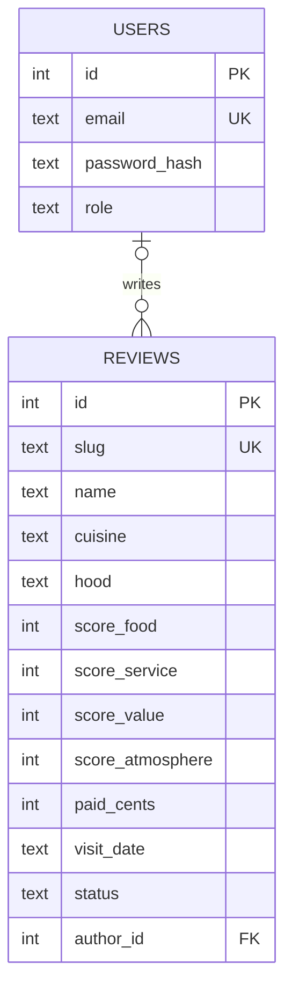

# Tab & Tip

Independent restaurant reviews in Chattanooga, TN. Every meal paid for, every visit unannounced, scored on the full 1 to 10 scale.

**Live site:** https://tab-and-tip.pages.dev

Hand-coded HTML, CSS and JavaScript, with a serverless API and SQL database on Cloudflare.

## How it works

```
Browser ──► Cloudflare Pages
              ├── public/          static pages, styles, front-end JS
              └── functions/api/   the API (Pages Functions)
                      └──► D1 database (tnt-db)
```

The pages never touch the database directly. They call the API, and the API is the only code that queries the database.

## API

| Endpoint | Returns |
|---|---|
| `GET /api/reviews` | every published review, newest first |
| `GET /api/reviews/:slug` | one published review, or 404 |

**Security notes**
- Column allowlist: only public columns are ever selected (no `SELECT *`)
- Visitor input (the slug) only reaches SQL through parameterized queries (`?` + `bind`)
- Drafts and missing reviews return the same 404, so drafts can't be discovered
- Errors are logged server-side; visitors get a generic message
- Responses are cached for 60 seconds to limit database reads

## Database

Cloudflare D1 (SQLite). Schema changes live in `migrations/`, one numbered file per change.

- Scores are stored in **tenths** (75 = 7.5) and money in **cents**, so the math is always exact
- `CHECK` constraints enforce the 1 to 10 scale and draft/published status
- The overall score is never stored; it's calculated from the four category scores



## Project layout

```
tab-and-tip/
├── public/               everything visitors can download
│   ├── index.html, reviews.html, our-standards.html, styles.css
│   └── js/               data.js (shared), home.js, reviews.js
├── functions/api/reviews/
│   ├── index.js          GET /api/reviews
│   └── [slug].js         GET /api/reviews/:slug
├── migrations/           database schema, one numbered change per file
├── seeds/                sample data for local testing
└── wrangler.jsonc        Cloudflare config
```

## Running locally

Requires Node.js and a Cloudflare account.

```
npm install
npx wrangler d1 migrations apply tnt-db --local
npx wrangler d1 execute tnt-db --local --file=seeds/sample_reviews.sql
npx wrangler pages dev
```

Then open http://localhost:8788

⚠️ `seeds/sample_reviews.sql` starts with `DELETE FROM reviews`. Never run it with `--remote` once real reviews exist.

## Roadmap

1. ~~Move reviews out of the HTML into data~~ ✓
2. ~~Database: Cloudflare D1~~ ✓
3. ~~API: Cloudflare Pages Functions, live deploy~~ ✓
4. Login: hashed passwords, secure session cookies, rate limiting
5. Critics' portal: dashboard, review editor, draft / publish, photo upload
6. Tests, review detail page, security write-up